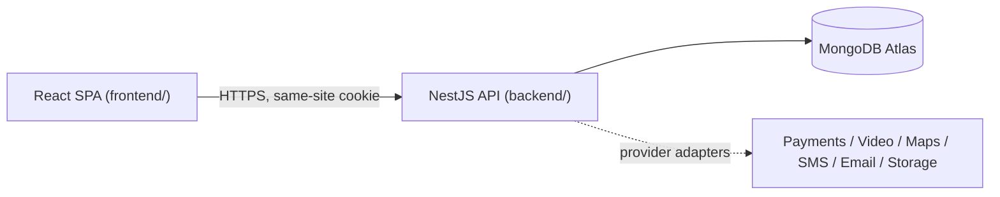

# Architecture

## 1. Summary

- **Shape:** a modular monolith. One NestJS API process and one React single-page app, kept in a
  single npm-workspaces repository.
- **Why not microservices:** the team is small, the domain is still changing, and booking,
  payments and dispatch need transactional consistency. A modular monolith gives clear module
  boundaries without distributed-systems overhead. A module can be extracted later if load or
  ownership requires it.
- **Database:** MongoDB Atlas through Mongoose. Atlas clusters are replica sets, so multi-document
  transactions are available when needed.
- **No Redis, queues, Docker or CI/CD for now.** They are added only when a measured need appears
  (see `OPEN_DECISIONS.md`).



## 2. Repository layout

```
healthcaresite/
├── package.json            npm workspaces + root scripts
├── docs/                   architecture, security, data model, roadmap …
├── backend/                NestJS modular monolith (API)
│   ├── .env.example                  copy to backend/.env (never committed)
│   ├── src/
│   │   ├── main.ts                   process entry (loads .env in dev, validates config)
│   │   ├── app.module.ts             wires modules + global guards
│   │   ├── bootstrap/                shared HTTP setup (helmet, cookies, CORS, pipes)
│   │   ├── config/                   Zod environment schema
│   │   ├── common/                   error filter, logging config, request helpers
│   │   ├── modules/
│   │   │   ├── access-control/       roles, permissions, permission guard
│   │   │   ├── audit/                append-only audit events
│   │   │   ├── auth/                 sessions, login, CSRF, passwords
│   │   │   ├── users/                user accounts
│   │   │   ├── admin/                privileged administration endpoints
│   │   │   └── health/               liveness + readiness
│   │   └── scripts/                  db:indexes, db:seed (explicit, never automatic)
│   └── test/                         integration tests (in-memory MongoDB replica set)
└── frontend/               React + Vite single-page app
    ├── public/
    └── src/
        ├── styles/                   design tokens + Tailwind entry
        ├── components/ui/            accessible primitives (button, input, card …)
        ├── components/layout/        header, footer, emergency notice, page shells
        ├── features/<domain>/        API calls, hooks, pages per domain (auth, account, admin …)
        ├── lib/                      API client, helpers
        └── pages/                    public static pages (home, not found …)
```

`backend/` and `frontend/` are independent packages with their own `package.json`. They are
linked as npm workspaces only so that one `npm install` and the root scripts cover both. They
share no code: the frontend talks to the backend purely over HTTP.

## 3. Backend module ownership

Each module owns its schemas, services, validation and permission checks. Other modules call its
service and never read its collections directly.

| Module                                                           | Owns                                                           | Status                         |
| ---------------------------------------------------------------- | -------------------------------------------------------------- | ------------------------------ |
| `auth`                                                           | sessions, login/logout, password changes, CSRF tokens, lockout | Phase 1 (built)                |
| `users`                                                          | user accounts and profile basics                               | Phase 1 (built)                |
| `access-control`                                                 | role → permission policy, guard, decorators                    | Phase 1 (built)                |
| `audit`                                                          | append-only security and access events                         | Phase 1 (built)                |
| `health`                                                         | liveness/readiness                                             | Phase 1 (built)                |
| `admin`                                                          | privileged user administration                                 | Phase 1 (read-only list built) |
| `catalog`                                                        | categories, specialties, services (DB-driven)                  | Phase 2                        |
| `providers`                                                      | doctor profiles, credentials, verification workflow            | Phase 2                        |
| `organizations`                                                  | clinics, hospitals, partners, memberships                      | Phase 2                        |
| `scheduling`                                                     | schedules, exceptions, slot generation, holds                  | Phase 3                        |
| `appointments`                                                   | booking lifecycle and status history                           | Phase 3                        |
| `home-visits`                                                    | service areas, matching, dispatch offers, ETA                  | Phase 3                        |
| `notifications`                                                  | templates, delivery attempts, provider adapters                | Phase 3                        |
| `payments`                                                       | payment intents, webhooks, refunds, invoices, settlements      | Phase 4                        |
| `consultations`                                                  | video sessions, waiting room, lifecycle                        | Phase 4                        |
| `medical-records`                                                | prescriptions, documents, sharing grants, access log           | Phase 4                        |
| `privacy`                                                        | consent records, data-subject requests                         | Phase 4                        |
| `support`                                                        | tickets and complaints                                         | Phase 4                        |
| `operations`                                                     | live ops dashboard queries, reassignment                       | Phase 3–4                      |
| `diagnostics`, `transport`, `home-care`, `insurance`, `packages` | Phase 6 modules                                                | Later                          |

## 4. Request lifecycle (API)

1. **Express + Helmet** set security headers. A 100 KB JSON body limit applies. Query strings are
   parsed in the simple (non-nested) form.
2. **pino-http** assigns a request ID. It reuses a valid `X-Request-Id` header or generates a UUID,
   then echoes it back. Log lines carry only the request ID, method, path (no query string),
   status and latency. Cookies and auth headers are redacted.
3. **Global guards** run in this order:
   1. `ThrottlerGuard`: per-IP rate limits, stricter on authentication routes.
   2. `SessionAuthGuard`: resolves the session cookie into `request.auth`. Routes are protected by
      default, and only routes marked `@Public()` skip authentication.
   3. `CsrfGuard`: for unsafe methods, the `Origin` must be on the allow-list. Authenticated
      requests must also send an `X-CSRF-Token` that matches the session.
   4. `PermissionsGuard`: enforces `@RequirePermissions(...)` against permissions derived on the
      server from the user's stored roles.
4. **ValidationPipe** (`whitelist` + `forbidNonWhitelisted`) rejects unknown fields, which blocks
   mass assignment.
5. The **controller** calls a module service. Business rules live in services, not controllers.
6. **AllExceptionsFilter** returns a stable error shape. Unexpected errors become a generic 500 with
   the request ID, and the full error is logged only on the server.

## 5. Frontend structure

- React Router for routing, with route-level code splitting via `lazy()`.
- TanStack Query holds server state. `useCurrentUser()` is the single source of truth for the
  session.
- React Hook Form + Zod handle forms. Client-side validation is for usability only, and the server
  validates again.
- In development the Vite dev server proxies `/api` to the API, so the browser sees one origin and
  cookies stay first-party.
- Business rules (pricing, availability, eligibility) are never computed in the UI. The UI renders
  what the API decides.

## 6. Integration adapters (ports and adapters)

Every external dependency sits behind an interface (a "port") in the owning module, for example
`PaymentGateway`, `VideoProvider`, `GeoProvider`, `NotificationChannel`, `DocumentStorage` and
`CredentialVerifier`. Each port has:

- one or more **real adapters** (for example Razorpay or 100ms), enabled by configuration, and
- a **development adapter** whose name says what it is (for example `DevConsoleEmailChannel`).

At startup the module chooses an adapter. **In production, a missing or development adapter is a
fatal configuration error**, so the app fails closed instead of silently faking payments or
notifications.

## 7. State machines

Bookings, payments, consultations and dispatch offers will each have an explicit transition table,
for example `appointments/appointment-state.ts`. The transition table is the only place that defines
legal transitions. Transitions are applied with conditional atomic updates such as
`findOneAndUpdate({ _id, status: from }, { status: to })`, so concurrent requests cannot both move
the same record. Every transition writes a status-history entry. Details are in `DATA_MODEL.md` §5.

## 8. Environments

| Environment   | Purpose           | Notes                                                           |
| ------------- | ----------------- | --------------------------------------------------------------- |
| `development` | Local desktop     | `.env` file, Vite proxy, dev adapters allowed, Swagger UI on    |
| `test`        | Automated tests   | In-memory MongoDB replica set, no network adapters              |
| `production`  | Future deployment | Real adapters required, Swagger off, secure cookies, HTTPS only |

A separate `staging` environment will use production settings with its own Atlas cluster and
credentials.
