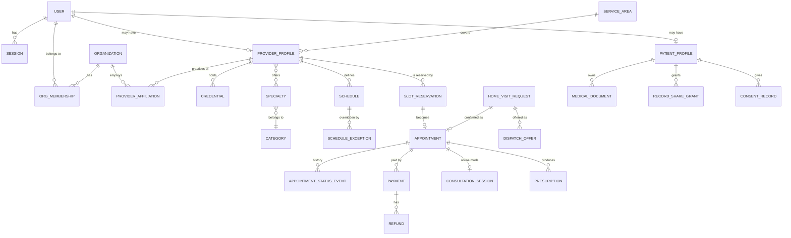

# Data Model

MongoDB Atlas via Mongoose. Schemas are designed around access patterns. Arrays are bounded,
history lives in separate collections instead of growing arrays, and every collection has explicit
indexes.

## 1. Conventions

- Collection names are plural snake_case (`audit_events`). Mongoose `timestamps` add `createdAt`
  and `updatedAt`.
- All times are stored in **UTC**. Schedules also store the provider's IANA time zone
  (`Asia/Kolkata`) so the server can expand local working hours correctly.
- References are `ObjectId`s. The owning module validates them before writing, because MongoDB has
  no foreign keys.
- Money is stored as **integer paise** (`amountMinor`) plus a `currency` (`INR`). Never floats.
- Status fields are string enums owned by a state machine (see §5). Every transition writes a
  history record.
- Client input never reaches a query as a raw object. DTO validation requires primitive types
  (strings, numbers, enum values), so a client cannot smuggle `$` operators into a filter.
  Mongoose `strictQuery` is on, so unknown filter fields are dropped. Mongoose's global
  `sanitizeFilter` is deliberately **not** used, because it would also neutralise operators that
  the server itself builds, such as `$gt` and `$in`.
- Indexes are declared in the schemas. In development, Mongoose builds them automatically. In
  production `autoIndex` is off and indexes are created explicitly with `npm run db:indexes -w
backend` during a release.

## 2. Collections implemented in Phase 1

### `users`

| Field                                                                     | Type                   | Notes                                                                                                               |
| ------------------------------------------------------------------------- | ---------------------- | ------------------------------------------------------------------------------------------------------------------- |
| `email`                                                                   | string                 | lower-cased, trimmed, **unique index**                                                                              |
| `fullName`                                                                | string                 | 2–100 characters                                                                                                    |
| `passwordHash`                                                            | string                 | Argon2id. Never selected by default (`select: false`)                                                               |
| `roles`                                                                   | string[]               | enum of roles. Bounded (at most 5). Default `['patient']`                                                           |
| `status`                                                                  | `active` \| `disabled` | disabled users cannot sign in                                                                                       |
| `emailVerifiedAt`                                                         | Date \| null           | set by the emailed verification link                                                                                |
| `mfaEnrolledAt`                                                           | Date \| null           | set when two-step verification is turned on                                                                         |
| `mfaSecret`, `mfaPendingSecret`                                           | string \| null         | authenticator secret, **AES-256-GCM encrypted** with `MFA_ENCRYPTION_KEY` and bound to the user ID. `select: false` |
| `mfaPendingExpiresAt`                                                     | Date \| null           | an unfinished set-up expires after 10 minutes                                                                       |
| `mfaLastUsedStep`                                                         | number \| null         | last accepted 30-second step, so a code cannot be replayed                                                          |
| `mfaRecoveryCodeHashes`                                                   | string[]               | HMAC-SHA-256 of unused recovery codes (keyed, bound to the user). `select: false`                                   |
| `failedLoginCount`                                                        | number                 | reset on successful login                                                                                           |
| `lockedUntil`                                                             | Date \| null           | temporary lockout                                                                                                   |
| `passwordChangedAt`                                                       | Date                   |                                                                                                                     |
| `termsAcceptedVersion`, `privacyNoticeAcceptedVersion`, `termsAcceptedAt` | string, string, Date   | interim record. Moves to `consent_records` in Phase 4                                                               |

Indexes: `{ email: 1 }` unique, `{ roles: 1, createdAt: -1 }` (admin listing).

### `sessions`

| Field           | Type             | Notes                                                                        |
| --------------- | ---------------- | ---------------------------------------------------------------------------- |
| `userId`        | ObjectId → users |                                                                              |
| `tokenHash`     | string           | SHA-256 of the cookie token, **unique index**. The raw token is never stored |
| `expiresAt`     | Date             | absolute expiry. **TTL index** (`expireAfterSeconds: 0`)                     |
| `idleExpiresAt` | Date             | sliding idle expiry, checked on every request                                |
| `lastSeenAt`    | Date             | updated at most every 5 minutes                                              |
| `revokedAt`     | Date \| null     | revoked sessions are rejected and later removed by the TTL                   |
| `mfaPending`    | boolean          | password accepted, code outstanding. Grants nothing; expires in 5 minutes    |
| `mfaVerifiedAt` | Date \| null     | when this session passed two-step verification                               |
| `userAgent`     | string           | truncated to 256 characters, shown on the active-sessions page               |
| `ipAddress`     | string           | shown to the owner. Removed with the session                                 |

Indexes: `{ tokenHash: 1 }` unique, `{ userId: 1, revokedAt: 1 }`, `{ expiresAt: 1 }` TTL.

### `account_tokens`

Single-use tokens for emailed links (email verification, password reset).

| Field       | Type                                     | Notes                                                                            |
| ----------- | ---------------------------------------- | -------------------------------------------------------------------------------- |
| `userId`    | ObjectId → users                         |                                                                                  |
| `purpose`   | `email_verification` \| `password_reset` | a token only works for its own purpose                                           |
| `tokenHash` | string                                   | SHA-256 of the emailed token, **unique index**. The raw token is never stored    |
| `email`     | string                                   | the address the link was sent to. Verification only succeeds if it still matches |
| `expiresAt` | Date                                     | 30 minutes for reset, 24 hours for verification. **TTL index**                   |
| `usedAt`    | Date \| null                             | set atomically when the link is used, so it works once                           |
| `createdAt` | Date                                     |                                                                                  |

Indexes: `{ tokenHash: 1 }` unique, `{ userId: 1, purpose: 1 }`, `{ expiresAt: 1 }` TTL. Issuing a
new token deletes that user's unused tokens of the same purpose, so only the latest link works.

### `doctor_applications`

A request to act as a doctor. Nothing in it is trusted until a reviewer approves it.

| Field                                                           | Type                                  | Notes                                                              |
| --------------------------------------------------------------- | ------------------------------------- | ------------------------------------------------------------------ |
| `userId`                                                        | ObjectId → users                      | the applicant                                                      |
| `status`                                                        | `pending` \| `approved` \| `rejected` | approval adds `doctor` to the user's roles in the same transaction |
| `registrationNumber`, `registrationCouncil`, `registrationYear` | string, string, number                | as entered by the applicant                                        |
| `qualification`, `specialty`                                    | string                                | free text for now; becomes catalogue-backed in Phase 2             |
| `registrationKey`                                               | string                                | council and number, lower-cased with punctuation removed           |
| `claimsRegistration`                                            | boolean                               | true while pending or approved                                     |
| `reviewedBy`, `reviewedAt`                                      | ObjectId \| null, Date \| null        |                                                                    |
| `rejectionReason`                                               | string \| null                        | shown to the applicant                                             |
| `reviewNote`                                                    | string \| null                        | internal only                                                      |
| `createdAt`, `updatedAt`                                        | Date                                  |                                                                    |

Indexes: `{ userId: 1, createdAt: -1 }`, `{ status: 1, createdAt: 1 }`, `{ userId: 1 }` unique
where `status: "pending"` (one open application per account), and `{ registrationKey: 1 }` unique
where `claimsRegistration: true` (one live application per registration).

### `doctor_profiles`

A doctor's public listing, created as an unpublished draft when their application is approved.

| Field                                                           | Type                           | Notes                                                                 |
| --------------------------------------------------------------- | ------------------------------ | --------------------------------------------------------------------- |
| `userId`                                                        | ObjectId → users               | **unique**                                                            |
| `applicationId`                                                 | ObjectId → doctor_applications | the approval this profile is based on                                 |
| `slug`                                                          | string                         | **unique**, for example `dr-meera-iyer-3f9a1c`                        |
| `displayName`, `specialty`, `qualification`                     | string                         | reviewed; copied on approval, not editable by the doctor              |
| `registrationNumber`, `registrationCouncil`, `registrationYear` | string, string, number         | reviewed                                                              |
| `registrationCheckedAt`                                         | Date                           | when the reviewer approved                                            |
| `specialtyKey`, `cityKey`                                       | string                         | lower-cased copies for exact filtering                                |
| `bio`, `languages`, `consultationModes`, `consultationFeeInr`   | string, enum[], enum[], int    | doctor-managed. Fee in whole rupees, 0–50,000                         |
| `clinicName`, `city`, `locality`                                | string \| null                 | doctor-managed; required to publish when in-clinic visits are offered |
| `published`, `publishedAt`                                      | boolean, Date \| null          |                                                                       |

Indexes: `{ userId: 1 }` unique, `{ slug: 1 }` unique, `{ published: 1, specialtyKey: 1, cityKey: 1 }`.
Directory queries also join `users` so only active accounts with the doctor role are listed.

### `doctor_schedules`

| Field            | Type                                           | Notes                                                                 |
| ---------------- | ---------------------------------------------- | --------------------------------------------------------------------- |
| `doctorUserId`   | ObjectId → users                               | **unique**                                                            |
| `rules`          | `[{ day 0–6, start, end, slotMinutes, mode }]` | India time "HH:mm"; no overlaps, no midnight crossing, 5-minute steps |
| `daysOff`        | string[]                                       | India dates `YYYY-MM-DD`; past dates are dropped when saved           |
| `bookingVersion` | int                                            | bumped by every booking transaction to serialise bookings per doctor  |

### `slot_reservations`

| Field                | Type                                                   | Notes                                      |
| -------------------- | ------------------------------------------------------ | ------------------------------------------ |
| `doctorUserId`       | ObjectId → users                                       |                                            |
| `startsAt`, `endsAt` | Date                                                   | UTC instants                               |
| `state`, `active`    | `held` \| `booked` \| `released` \| `expired`, boolean | `active` is true only while held or booked |
| `holdExpiresAt`      | Date \| null                                           | set while `held`                           |
| `appointmentId`      | ObjectId → appointments                                |                                            |

Indexes: `{ doctorUserId: 1, startsAt: 1 }` unique where `active: true`
(`one_active_claim_per_slot`), `{ doctorUserId, active, startsAt, endsAt }`, `{ state, holdExpiresAt }`.

### `appointments`

| Field                                  | Type                             | Notes                                                                                          |
| -------------------------------------- | -------------------------------- | ---------------------------------------------------------------------------------------------- |
| `patientId`, `patientName`             | ObjectId → users, string         | name copied at booking for the doctor's list                                                   |
| `doctorUserId`, `doctor`               | ObjectId → users, snapshot       | slug, name, specialty and clinic copied at booking                                             |
| `reservationId`                        | ObjectId → slot_reservations     |                                                                                                |
| `startsAt`, `endsAt`, `mode`           | Date, Date, `clinic` \| `online` |                                                                                                |
| `status`                               | see §5                           |                                                                                                |
| `feeInr`                               | int                              | from the profile at booking time, never from the browser                                       |
| `payment`                              | object                           | `status`, `amountPaise`, `orderId`, `paymentId`, `paidAt`, `refunds[]`                         |
| `holdExpiresAt`, `confirmedAt`         | Date \| null                     | doctors only see appointments with `confirmedAt`                                               |
| `patientNote`                          | string \| null (≤ 500)           | **health information**: shown to the patient and doctor only; never logged, audited or emailed |
| `idempotencyKey`, `requestFingerprint` | string                           | see §4                                                                                         |
| `cancelledAt`, `cancelReason`          | Date \| null, string \| null     |                                                                                                |

Indexes: `{ patientId, idempotencyKey }` unique, `{ patientId, startsAt: -1 }`,
`{ doctorUserId, startsAt }`, `{ payment.orderId }` unique when set, `{ status, holdExpiresAt }`.

### `appointment_events` and `payment_webhook_events`

`appointment_events` is the append-only history of an appointment (`created`, `payment_captured`,
`hold_expired`, `cancelled_by_*`, `refund_started`, `refund_processed`, `refund_failed`,
`completed`, `no_show`) with `fromStatus`, `toStatus`, `source` and `actorUserId`.
`payment_webhook_events` stores handled Razorpay event IDs (unique, 90-day TTL) so retried
deliveries are not processed twice.

### `audit_events`

| Field                    | Type                               | Notes                                                                      |
| ------------------------ | ---------------------------------- | -------------------------------------------------------------------------- |
| `action`                 | string                             | for example `auth.login.succeeded`, `admin.users.listed`                   |
| `outcome`                | `success` \| `failure` \| `denied` |                                                                            |
| `actorUserId`            | ObjectId \| null                   | null for anonymous attempts                                                |
| `targetType`, `targetId` | string, string                     | what was acted on                                                          |
| `requestId`, `ipAddress` | string                             | correlation with logs                                                      |
| `metadata`               | object                             | small, allow-listed keys only (for example `reason`). Never PHI or secrets |
| `createdAt`              | Date                               |                                                                            |

Indexes: `{ createdAt: -1 }`, `{ actorUserId: 1, createdAt: -1 }`, `{ action: 1, createdAt: -1 }`.
There are no update or delete code paths. Retention will be enforced by a reviewed archival job, not
by a TTL index.

## 3. Planned entities and relationships

| Collection                                                                                          | Phase | Key design points                                                                                                                                                                                                                       |
| --------------------------------------------------------------------------------------------------- | ----- | --------------------------------------------------------------------------------------------------------------------------------------------------------------------------------------------------------------------------------------- |
| `categories`, `specialties`                                                                         | 2     | Admin-editable. Each has a slug, `medicalSystem` (allopathy/ayurveda/homeopathy …), `practitionerType` (psychiatrist vs psychologist vs counsellor), allowed visit modes and an `isActive` flag                                         |
| `provider_profiles`                                                                                 | 2     | `verificationStatus` (`draft → submitted → under_review → verified / rejected / suspended`). Only `verified` profiles are public. Holds languages, visit modes, fees, `homeVisitBase` (GeoJSON Point, `2dsphere`) and `serviceRadiusKm` |
| `credentials`                                                                                       | 2     | registration council, number, year, document reference, verifier ID, verifiedAt. Unique on `{council, registrationNumber}`                                                                                                              |
| `organizations`, `organization_memberships`, `provider_affiliations`                                | 2     | Memberships carry an org-scoped role. Every org query filters by membership                                                                                                                                                             |
| `schedules`, `schedule_exceptions`                                                                  | 3     | Weekly rules in local time (a rule may cross midnight, for example 22:00–06:00), slot length, buffer, mode, location. Exceptions cover leave and holidays                                                                               |
| `public_holidays`                                                                                   | 3     | Per state or region (`IN` = national today), used by `availWhen=public_holiday`. Seed with `npm run db:seed-public-holidays -w backend`; when empty, the built-in date list is used                                                                 |
| `service_areas`                                                                                     | 3     | Pilot PIN codes today (`pinCode`, `stateCode`, `label`, `active`); seed with `db:seed-service-areas`. GeoJSON polygons and ETAs later                                                                                                   |
| `home_visit_requests`, `dispatch_offers`                                                            | 3     | An offer has `expiresAt`. Accepting is a conditional update                                                                                                                                                                             |

**Today (pre–home-visit):** booking uses `doctor_profiles` with `consultationModes: ['online' |
'clinic']` only. The patient dashboard `homeVisits` block is a static placeholder until
`service_areas`, `home_visit_requests` and dispatch exist; the directory does not filter by home
visit yet.
| `idempotency_keys`                                                                                  | 3     | `{ scope, key }` unique, stores the response hash, TTL 24 h                                                                                                                                                                             |
| `payments`, `refunds`, `payment_webhook_events`, `invoices`, `settlements`                          | 4     | Webhook events unique on the provider event ID                                                                                                                                                                                          |
| `consultation_sessions`                                                                             | 4     | Short-lived join tokens are issued on request and never stored in plain text                                                                                                                                                            |
| `prescriptions`, `prescription_amendments`                                                          | 4     | Immutable once signed. Changes are amendments                                                                                                                                                                                           |
| `medical_documents`, `record_share_grants`, `record_access_logs`                                    | 4     | Files live in private object storage. Each download is authorized and logged                                                                                                                                                            |
| `consent_records`, `data_subject_requests`                                                          | 4     | Append-only consent history (given, withdrawn, version, purpose)                                                                                                                                                                        |
| `notifications`, `notification_attempts`                                                            | 3     | Attempts are separate so retries never grow arrays                                                                                                                                                                                      |
| `support_tickets`, `support_ticket_events`                                                          | 4     |                                                                                                                                                                                                                                         |
| `diagnostic_orders`, `transport_requests`, `care_plans`, `packages`, `vouchers`, `insurance_checks` | 6     |                                                                                                                                                                                                                                         |

## 4. Booking concurrency design (implemented)

The goal is that a doctor's time can be held or booked by **at most one** active claim.

1. `slot_reservations` has a **partial unique index** on `{ doctorUserId, startsAt }` where
   `active: true` (`held` and `booked` claims are active; `released` and `expired` are not).
2. **Per-doctor serialisation:** every booking transaction first increments
   `doctor_schedules.bookingVersion` for that doctor. Two bookings for the same doctor therefore
   write-conflict, and MongoDB retries the later one after the first commits. This keeps the
   overlap check below reliable even when a timetable change produces slots of different lengths
   that overlap without sharing a start time.
3. **Inside the transaction:** expire this doctor's `held` claims whose `holdExpiresAt` has passed
   (and their `pending_payment` appointments), check that no active claim overlaps
   `[startsAt, endsAt)`, insert the claim, insert the appointment, write the first event. Any clash
   or duplicate key returns `409 SLOT_UNAVAILABLE`.
4. **Paid bookings** start as `held` for 10 minutes with appointment status `pending_payment`.
   **Free bookings** (fee 0) are inserted as `booked` / `confirmed` directly.
5. **Confirm payment:** one transaction moves the claim `held → booked` with a conditional update
   on `state: 'held'` and the appointment `pending_payment → confirmed`. A claim that is still
   `held` after its deadline has not been taken by anyone, so it may still be confirmed. If the
   claim was already expired (someone else booked the time), the payment is refunded in full and
   the appointment is `expired`. A refund is claimed atomically per payment ID, so retries and
   webhook replays never refund twice.
6. **Cancel:** one transaction moves the appointment to `cancelled_by_*` and the claim to
   `released`; a paid appointment is then refunded in full.
7. **Idempotency:** `POST /appointments` requires an `Idempotency-Key`. The key and a hash of the
   request are stored on the appointment with a unique index on `{ patientId, idempotencyKey }`. A
   repeated key with the same body returns the existing appointment; a different body returns `422`.

Automated tests cover parallel bookings for the same slot, idempotent repeats and key reuse, hold
expiry, late payments, webhook replays, refunds and India-time day boundaries.

## 5. State machines

- **Appointment (implemented):** `pending_payment → confirmed → completed | no_show`, with exits
  `pending_payment → expired | cancelled_by_patient` and `confirmed → cancelled_by_patient |
cancelled_by_doctor`. `checked_in` and `in_progress` may be added with video consultations.
- **Payment (implemented, on the appointment):** `pending → paid → refund_pending → refunded`, or
  `refund_failed` (needs manual follow-up); `not_required` for free consultations.
- **Home-visit request:** `requested → matching → offered → accepted → en_route → arrived →
completed`, with exits to `unassigned`, `cancelled` and `reassigned`.
- **Dispatch offer:** `offered → accepted | declined | expired | withdrawn`.

## 6. Retention and deletion (draft — requires legal review)

| Data                              | Proposed approach                                                                                                                                         |
| --------------------------------- | --------------------------------------------------------------------------------------------------------------------------------------------------------- |
| Sessions                          | Removed automatically after expiry (TTL)                                                                                                                  |
| Audit events                      | Retained (period to be set by legal review), archived, never edited                                                                                       |
| Medical records and prescriptions | Retained per applicable medical-records rules. Patient "delete" requests are assessed against legal retention duties                                      |
| Financial records                 | Retained per tax and accounting law                                                                                                                       |
| Marketing and analytics data      | Minimal. Deleted on consent withdrawal                                                                                                                    |
| Accounts (self-service deletion)  | Implemented. The user, sessions, account tokens, doctor application, profile and timetable are hard-deleted. Appointments and audit events stay (see A20) |

## 7. Schema changes and seeds

- **Additive changes** (new optional fields, new indexes) ship with the code. Run `npm run
db:indexes -w backend` on release.
- **Data migrations** (renames, backfills) will use versioned scripts recorded in a
  `schema_migrations` collection. Each needs a backup, a dry run on staging and a rollback note.
  They never run automatically on app start.
- **Seeds:** `npm run db:seed -w backend` creates **synthetic** users with `.test` email addresses.
  It refuses to run unless `NODE_ENV=development`.
